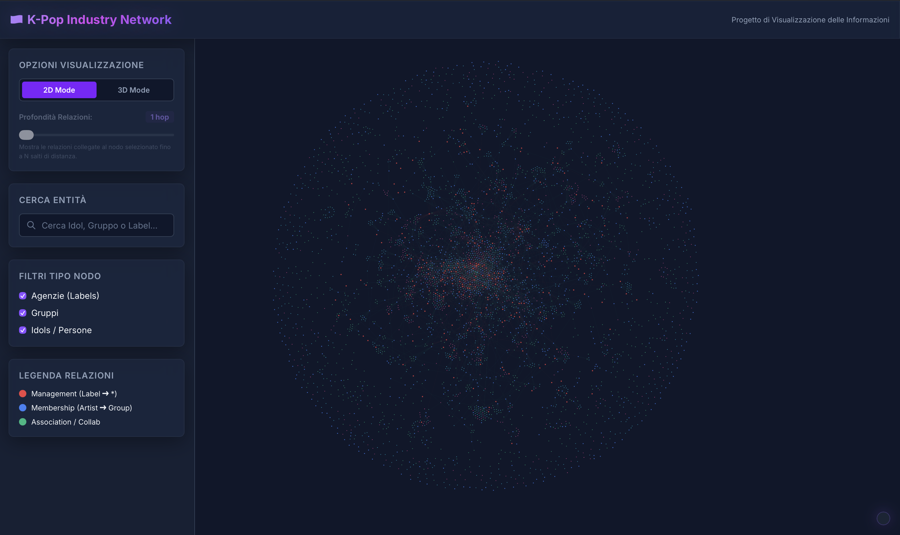
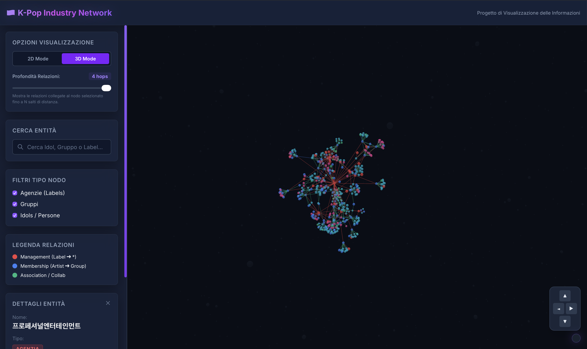
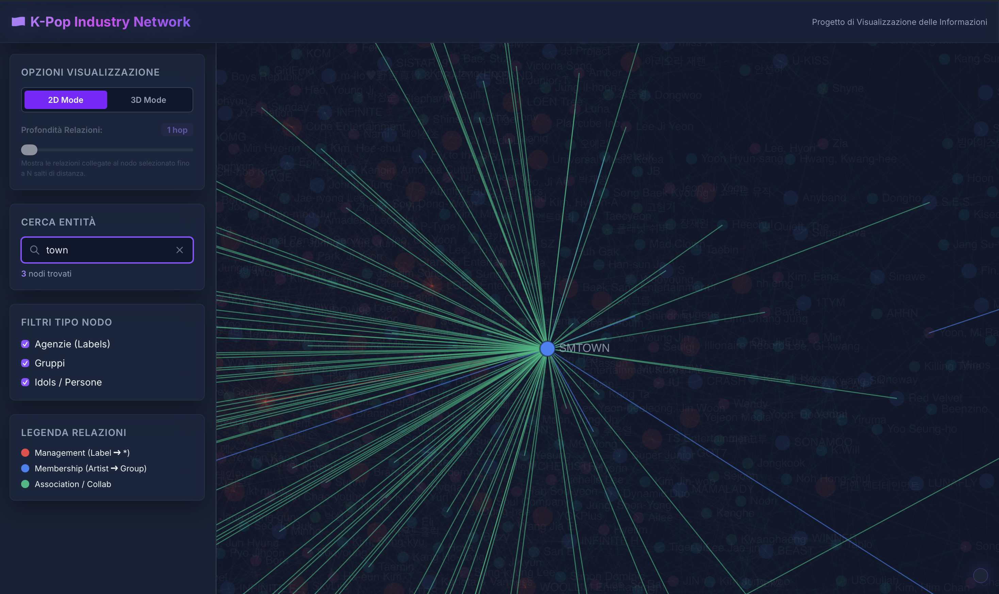

# 🇰🇷 K-Pop Network Analysis — Visualizing the K-Pop Industry

An advanced, interactive web application for exploring and visualizing the relationship network within the **Korean Pop (K-Pop)** music industry.

The system models the connections between major **record labels (agencies)**, **music groups**, and **individual artists (idols)** through interactive graphs in **2D and 3D modes**, enabling in-depth analysis of corporate structures, group memberships, and artistic collaborations.

---

### 🎨 2D Visualization (Canvas API & D3 Force)

*High-performance, force-directed two-dimensional visualization rendered using the Canvas 2D API. Supports zoom, pan, node dragging, and highlighting of first-level neighbors.*

---

### 🌐 3D Visualization (WebGL & Orbit Controls)

*High-framerate 3D WebGL visualization featuring 360° orbit controls, spatial simulation, a floating UI direction widget, and a BFS depth slider for exploring relational hops.*

---

### 🔍 Search and Entity Details

*Instant search panel with real-time highlighting, entity type filtering, and an interactive info card for navigating connected relationships.*

---

## ✨ Key Features

* **Dual-Mode 2D & 3D:** Instant toggle between the 2D view (Canvas API + D3.js) and the 3D view (WebGL + Three.js / Orbit Controls).
* **Full 3D Orbit Controls:** 360° 3D camera control with a fixed axis (Pole Lock) and a floating navigation widget with directional arrows (◄ ► ▲ ▼) for guided orientation.
* **Dynamic Relational Depth (BFS Hops):** A slider in 3D mode to explore the network of connections around a selected node at a scalable depth (from 1 to 4 hops away).
* **Entity Type Filters:** Ability to dynamically filter graph nodes by:
  * 🏢 **Agencies (Labels):** *e.g., SM Entertainment, HYBE, YG, JYP*
  * 👥 **Music Groups:** *e.g., BTS, BLACKPINK, EXO, TWICE*
  * 👤 **Idols / People:** *Individual male and female artists*
* **Debounced Instant Search:** Real-time search by entity name with visual isolation of matching results.
* **Smooth Focus & Target Tracking:** Automatic, smooth camera transition centering on the selected node in both 2D and 3D views.
* **Interactive Details Card:** A dynamic sidebar showing the entity type, count of active relationships, and a clickable list of all direct connections.

---

## 🛠️ Technology Stack

* **Frontend Logic:** Modular ES6 JavaScript (Mixin Architecture: `data.js`, `renderer.js`, `renderer3d.js`, `navigation.js`, `selection.js`, `interaction.js`, `filters.js`, `search.js`, `graph.js`).
* **Physics Engine:** [D3.js v7](https://d3js.org/) (`d3-force` for 2D physical simulation and force calculations).
* **3D Engine:** [3d-force-graph](https://github.com/vasturiano/3d-force-graph) / [Three.js](https://threejs.org/) (WebGL rendering and `OrbitControls`).
* **2D Rendering:** HTML5 Canvas 2D API optimized with off-viewport coordinate culling.
* **Styling & UI:** [Tailwind CSS v4](https://tailwindcss.com/) + Google Fonts typography (Inter).

---

## 📂 Project Structure

```
visualizzazione dei dati/
├── README.md                      # Main project documentation
├── data/                          # Source CSV dataset
│   ├── K-pop_node.csv             # Node definitions (id, name, type)
│   └── K-pop_edge.csv             # Relationship definitions (source, target)
├── docs/                          # Technical documentation and media
│   ├── TECHNICAL_DOCUMENT.md      # Technical project report
│   ├── HOW_IT_WORKS.md            # Architectural/how-it-works guide
│   ├── OPTIMIZATIONS.md           # Performance optimization notes
│   └── screenshots/               # Folder for application screenshots
│   ├── index.html                 # HTML structure of the application
│   ├── style.css                  # Custom styles and CSS utilities
│   └── js/                        # ES6 JavaScript modules
│       ├── config.js              # Colors, radii, and forces configuration
│       ├── data.js                # CSV data loading and parsing
│       ├── filters.js             # View filters management
│       ├── graph.js               # Main KPopNetworkGraph class
│       ├── interaction.js         # 2D mouse events (pan, drag, zoom)
│       ├── main.js                # Application entry point
│       ├── navigation.js          # Smooth framing and zoom reset
│       ├── renderer.js            # 2D Canvas rendering engine
│       ├── renderer3d.js          # 3D WebGL rendering engine & OrbitControls
│       ├── search.js              # Search and entity highlighting
│       └── selection.js           # Selection management and details sidebar
└── scripts/                       # Helper scripts for cleaning/deduplication
    └── deduplicate.js
```

---

## 📊 CSV Data Format

The application loads data in real time from the CSV files located in the `data/` folder:

### 1. `K-pop_node.csv` (4,674 Entities)
| Field | Type | Description | Allowed Values |
|---|---|---|---|
| `id` | String | Unique identifier of the entity | e.g., `SM_Entertainment`, `BTS` |
| `name` | String | Human-readable name of the entity | e.g., `SM Entertainment`, `BTS` |
| `type` | String | Category of the entity | `label`, `group`, `person`, `male`, `female` |

### 2. `K-pop_edge.csv` (5,094 Relationships)
| Field | Type | Description | Inferred Relationship |
|---|---|---|---|
| `source` | String | ID of the source entity | `label` ➔ Management |
| `target` | String | ID of the target entity | `artist` ➔ `group` (Membership) |

---

## 🚀 Local Setup & Running

Since the application uses **ES6 Modules** and loads CSV files via `fetch`/`d3.csv`, it must be served through a local web server.

### Method 1: Node.js / `npx serve` (Recommended)
Run in the project directory:
```bash
npx serve kpop-graph
```
Open the address shown in the terminal in your browser (e.g., `http://localhost:3000`).

### Method 2: Python HTTP Server
Run in the project root:
```bash
python -m http.server 8000
```
Open in your browser: `http://localhost:8000/kpop-graph/`

### Method 3: VS Code Live Server
Open the folder in Visual Studio Code and click **"Go Live"** to start the Live Server extension on the `kpop-graph/index.html` file.
